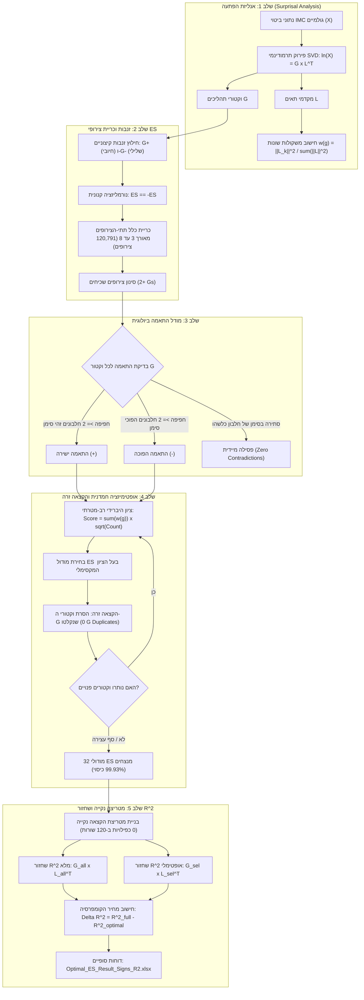

# מדריך אלגוריתמי מקיף: מהלך האלגוריתם, הרציונל הביולוגי והמתמטי

**פרויקט גמר: ניתוח Surprisal Analysis, כריית רצפי סימנים מדויקים (ES) ושחזור R² ברמת התא הבודד**  
*מחקר בסביבת המיקרו-סביבה הגידולית (Tumor Microenvironment - TME) בשיטת Imaging Mass Cytometry (IMC)*

---

## תוכן עניינים
1. [מבוא והאתגר המדעי בסביבת הגידול (TME)](#1-מבוא-והאתגר-המדעי)
2. [אנליזת הפתעה (Surprisal Analysis) – פירוק מתמטי ופיזיקלי](#2-אנליזת-הפתעה-surprisal-analysis)
3. [מושג ה-"זנבות" (Tails: G+ ו-G-) כמניעי תהליכים](#3-מושג-ה-זנבות-tails-g-ו-g-)
4. [רצפי סימנים מדויקים (Exact Sign Sequences - ES)](#4-רצפי-סימנים-מדויקים-exact-sign-sequences---es)
5. [כריית מרחב הצירופים: ההבחנה בין בודדים (Singletons) לשכיחים (2+ Gs)](#5-כריית-מרחב-הצירופים)
6. [מודל ההתאמה הביולוגית וכלל אפס הסתירות (Zero Contradictions)](#6-מודל-ההתאמה-הביולוגית-וכלל-אפס-הסתירות)
7. [האלגוריתם החמדן ופונקציית המטרה ההיברידית (The Hybrid Model)](#7-האלגוריתם-החמדן-ופונקציית-המטרה-ההיברידית)
8. [השוואת 6 אסטרטגיות עוגן ויציבות ההתכנסות הביולוגית](#8-השוואת-6-אסטרטגיות-עוגן)
9. [בניית מטריצת ההקצאה הנקייה (Conflict-Free Matrix)](#9-בניית-מטריצת-ההקצאה-הנקייה)
10. [שחזור ואימות איכות ברמת התא הבודד (R² ו-ΔR²)](#10-שחזור-ואימות-איכות-ברמת-התא-הבודד)
11. [בחינת האלגוריתם על הדאטאסט הנוסף (Evaluation Cohort)](#11-בחינת-האלגוריתם-על-הדאטאסט-הנוסף)
12. [סכמת זרימה חזותית מלאה (Workflow Schema)](#12-סכמת-זרימה-חזותית-מלאה)
13. [מדריך שימוש בממשק המשתמש (GUI Workbench)](#13-מדריך-שימוש-בממשק-המשתמש-gui)

---

## 1. מבוא והאתגר המדעי

במחקרי סרטן מודרניים, גידול אינו מהווה גוש הומוגני של תאים סרטניים בלבד, אלא מערכת אקולוגית מורכבת הנקראת **המיקרו-סביבה הגידולית (Tumor Microenvironment - TME)**. סביבה זו כוללת תאי חיסון מגוונים (כגון לימפוציטים מסוג T ו-B, מקרופאגים), תאים סטרומליים (פיברובלסטים תומכי גידול - CAFs), תאי אנדותל של כלי דם, ותאים סרטניים בשלבי התמיינות שונים.

באמצעות טכנולוגיית **Imaging Mass Cytometry (IMC)** ניתן למדוד בו-זמנית עשרות סמנים חלבוניים ברמת התא הבודד תוך שימור המיקום המרחבי המדויק ברקמה. במחקר זה נדגמו **120 סקשנים רקמתיים (ROIs) מ-19 חולים**, המכילים יחד מאות אלפי תאים.

### האתגר החישובי:
הנתונים הגולמיים רועשים, בעלי ממדיות עצומה ושונות ביולוגית גבוהה בין חולה לחולה. מטרת האלגוריתם היא:
1. **לפרק** את השונות התאית לתהליכים ביולוגיים בלתי-תלויים.
2. **לזהות** רשת מינימלית ואופטימלית של **תבניות חלבוניות משותפות (Exact Sign Sequences - ES)** החוזרות ונשנות באוכלוסיית החולים.
3. **לשמר במדויק את כיוון הפעילות** (האם חלבון מוגבר `+` או מדוכא `-`).
4. **לשחזר** את המידע הביולוגי המקורי ברמת התא הבודד לפי מדד $R^2$, עם מינימום אובדן מידע ומקסימום כיווץ (קומפרסיה).

---

## 2. אנליזת הפתעה (Surprisal Analysis)

שיטת ה-**Surprisal Analysis** מבוססת על עקרונות תרמודינמיים מתורת האינפורמציה. היא מניחה כי ביטוי החלבונים בכל תא נובע משילוב של:
1. **מצב שיווי משקל סטטיסטי (State of Maximum Entropy / Equilibrium):** מיוצג ע"י האינדקס $0$ ($G_0, L_0$). זהו הפרופיל הבסיסי המשותף לכלל התאים ברקמה.
2. **אילוצים והפרעות ביולוגיות (Biological Constraints / Deviations):** מיוצגים ע"י רכיבי הסטייה $k \ge 1$ ($G_1, G_2, \dots, G_K$). כל רכיב כזה מייצג מסלול איתות עצמאי, תגובה חיסונית, מצב היפוקסיה, חלוקת תא, או פנוטיפ פולשני.

מבחינה מתמטית, עבור מטריצת הביטוי החלבוני $X$ (בגודל $N_{proteins} \times N_{cells}$), הפירוק הלוגריתמי מוגדר כ:
$$\ln(X_{i,j}) = \sum_{\alpha=0}^K G_{i,\alpha} \cdot L_{j,\alpha} = \left( G \times L^T \right)_{i,j}$$

* **וקטור $G_\alpha$ (גודל $N_{proteins}$):** מתאר את "טביעת האצבע" החלבונית של התהליך הביולוגי $\alpha$. ערכים חיוביים מעידים על ביטוי יתר, וערכים שליליים מעידים על דיכוי.
* **וקטור $L_\alpha$ (גודל $N_{cells}$):** מתאר את עוצמת הפעילות של תהליך $\alpha$ בכל תא בודד $j$.

### משקולת השונות הפיזיקלית $w(g)$:
לא כל תהליכי ה-$G$ חשובים במידה שווה. האנרגיה הכוללת של תהליך $k$ בסקשן רקמתי נמדדת לפי גודל מקדמי התאים שלו:
$$\|L_k\|^2 = \sum_{j=1}^{N_{cells}} L_{j,k}^2$$
משקל התרומה של וקטור סטייה $g = (ROI, G_k)$ לשונות הכוללת של הרקמה מוגדר כ:
$$w(g) = \frac{\|L_k\|^2}{\sum_{\alpha \ge 1} \|L_\alpha\|^2}$$
כך שסכום המשקולות של כל וקטורי הסטייה בסקשן הוא בדיוק $1.0$ (100% שונות). וקטורים ראשונים ($G_1, G_2$) נושאים לעיתים קרובות 30%-50% מהשונות, בעוד וקטורים אחרונים נושאים פחות מ-1%.

---

## 3. מושג ה-"זנבות" (Tails: G+ ו-G-)

בהתפלגות ערכי $G$, רוב החלבונים מתרכזים סביב האפס — כלומר, הם אינם משתתפים באופן פעיל באותו תהליך ספציפי ומהווים רעש רקע. 
החלבונים המשמעותיים באמת מרוכזים ב-**"זנבות" (Tails)** של ההתפלגות:
* **זנב חיובי ($G+$):** חלבונים בעלי מקדם חיובי גבוה — הם מבוטאים ביתר כאשר התהליך פעיל.
* **זנב שלילי ($G-$):** חלבונים בעלי מקדם שלילי מובהק — הם מדוכאים כאשר התהליך פעיל.

במערך הנתונים של ה-TME חולצו מכל וקטור $G$ עד 4 חלבוני זנב חיוביים ועד 4 חלבוני זנב שליליים. סך הכל חולצו **2,778 וקטורי $G$** על פני 120 הסקשנים, כאשר אורך הזנב נע בין 2 ל-8 חלבונים (חציון: 6 חלבונים).

---

## 4. רצפי סימנים מדויקים (Exact Sign Sequences - ES)

רצף ES הוא מילון המגדיר תת-קבוצה של חלבונים ואת הסימן המדויק של כל אחד מהם:
$$\text{ES} = \{ \text{CD3: } +1, \text{CD8: } +1, \text{CD20: } +1, \text{HLADR: } -1 \}$$
המשמעות הביולוגית: קואורדינציה שבה נוכחות של תאי T ציטוטוקסיים ותאי B מלווה בהיעדר מולקולות הצגת אנטיגן.

### נורמליזציה קנונית (Canonical Representation):
בווקטורים עצמיים, כיוון הווקטור נקבע שרירותית:
$$G \times L^T = (-G) \times (-L)^T$$
רצף שכל סימניו הפוכים ($-\text{ES}$) מתאר למעשה את אותו תהליך בדיוק (פשוט התאים שבהם $L > 0$ עוברים ל-$L < 0$).
כדי למנוע רישום כפול של תהליכים זהים, מוגדרת **פונקציה קנונית**:
1. ממיינים את החלבונים לפי סדר אלפביתי.
2. אם לחלבון הראשון יש סימן מינוס (`-`), הופכים את כל הסימנים ברצף.
3. כך, כל רצף מיוצג באופן חד-חד-ערכי (Canonical Key).

---

## 5. כריית מרחב הצירופים

מתוך 2,778 וקטורי ה-$G$ נכרו **כל תתי-הצירופים הקנוניים האפשריים** החל מאורך 3 חלבונים ועד לאורך 8 חלבונים:

| אורך הרצף | סך כל הצירופים הייחודיים | צירופים שכיחים (מופיעים ב-2+ Gs) | אחוז שכיחות | דוגמה לצירוף שכיח מוביל |
| :---: | :---: | :---: | :---: | :--- |
| **3** | 18,081 | 6,589 | 36.4% | `CD20(+) \| CD3(+) \| CD8(+)` (ב-80 וקטורים) |
| **4** | 43,866 | 9,878 | 22.5% | `CD20(+) \| CD3(+) \| CD31(-) \| HLADR(-)` (ב-38 וקטורים) |
| **5** | 37,085 | 5,302 | 14.3% | `CD20(+) \| CD3(+) \| CD31(-) \| CD8(+) \| HLADR(-)` (ב-24 וקטורים) |
| **6** | 16,922 | 1,446 | 8.5% | `C11(+) \| CD20(-) \| CD3(-) \| CD31(+) \| CD8(-) \| HLADR(+)` (ב-13 וקטורים) |
| **7** | 4,344 | 277 | 6.4% | `C11(+) \| CD20(-) \| CD3(-) \| CD31(+) \| CD8(-) \| HLADR(+) \| Ki67(+)` (ב-7 וקטורים) |
| **8** | 493 | 19 | 3.8% | `CD11c(+) \| CD163(-) \| CD20(+) \| CD3(+) \| CD31(-) \| HLADR(-) \| LAG3(-) \| PDPN(+)` (ב-2 וקטורים) |
| **סה"כ** | **120,791** | **23,511** | **19.5%** | **מרחב המועמדים הכולל של המחקר** |

### מדוע ההבחנה בין Singletons ל-2+ Gs קריטית?
* **צירופים בודדים (Singletons - 80.5%):** הופיעו בווקטור יחיד בכל המחקר (בחולה בודד). אלו רעשים או שונות פרטנית נקודתית.
* **צירופים שכיחים (2+ Gs - 19.5%):** הופיעו בלפחות 2 וקטורים שונים. חזרתיות זו היא ההוכחה האמפירית לכך שמדובר ב**חוק טבע ביולוגי רובוסטי** ולא במקריות סטטיסטית.

---

## 6. מודל ההתאמה הביולוגית וכלל אפס הסתירות

כאשר בוחנים האם מודול ES מכסה וקטור $G$:
1. **חפיפה מינימלית:** קבוצת החלבונים המשותפת $\text{Common} = \text{Prots}(ES) \cap \text{Prots}(G)$ חייבת לכלול לפחות 2 חלבונים.
2. **התאמה ישירה (Direct Match `+`):** כל החלבונים המשותפים מופיעים עם אותו סימן בדיוק.
3. **התאמה הפוכה (Inverse Match `-`):** כל החלבונים המשותפים מופיעים עם סימן הפוך בדיוק.
4. **כלל אפס הסתירות (Zero Contradictions):**  
   אם אפילו חלבון משותף אחד סותר בסימנו (למשל CD8+ במודול מול CD8- בווקטור, בעוד שאר החלבונים תואמים) — **ההתאמה נפסלת באופן מוחלט ומיידי!**

---

## 7. האלגוריתם החמדן ופונקציית המטרה ההיברידית

בבעיית Set Cover קלאסית במדעי המחשב, כל איבר שווה 1. אך ב-Surprisal Analysis, וקטור $G_1$ שמסביר 40% מהשונות חשוב פי 40 מווקטור $G_{25}$ שמסביר 1%.

לכן פותחה **פונקציית המטרה ההיברידית (Hybrid Multi-Objective Function)**:
$$\text{Score}(ES) = \left[ \sum_{g \in \text{New}(ES)} w(g) \right] \times \sqrt{|\text{New}(ES)|}$$

* **הרכיב הראשון ($\sum w(g)$):** מבטיח מקסום של השונות הפיזיקלית ואיכות שחזור ה-$R^2$.
* **הרכיב השני ($\sqrt{\text{Count}}$):** מעניק יתרון למודולים אוניברסליים המשותפים למספר רב של חולים, אך עם שורש כדי למנוע השתלטות של מודולים גנריים קצרים.

### הקצאה זרה (Disjoint G-Allocation):
כל וקטור $G$ שנקלט ע"י מודול מסוים מוסר ממאגר הווקטורים הפנויים. התוצאה: **אפס כפילויות של וקטורי $G$ בין המודולים השונים**.

---

## 8. השוואת 6 אסטרטגיות עוגן

אלגוריתם חמדן תלוי בנקודת הפתיחה ("עוגן"). כדי להוכיח שהתוצאות אינן מקריות, נבדקו 6 אסטרטגיות עוגן שונות:

| אסטרטגיה | מודולי ES | וקטורי G מכוסים | אחוז כיסוי | שונות מוסברת | ממוצע $R^2_{optimal}$ | מחיר קומפרסיה $\Delta R^2$ | סקשנים איכותיים |
| :--- | :---: | :---: | :---: | :---: | :---: | :---: | :---: |
| **1. SVD Variance Driver** | 31 | 2,775 | 99.89% | 87.60% | 0.8837 | 0.0785 | 92.5% |
| **2. Max Frequency (Universality)** | 31 | 2,774 | 99.86% | 87.57% | 0.8834 | 0.0788 | 92.5% |
| **3. Deep Specificity (Lengths 7-8)** | 32 | 2,775 | 99.89% | 87.59% | 0.8837 | 0.0785 | 91.7% |
| **4. Immune Hallmark (`CD3/CD8`)** | 33 | 2,775 | 99.89% | 87.59% | 0.8836 | 0.0787 | 92.5% |
| **5. Stroma Hallmark (`FAP/SMA`)** | 34 | 2,774 | 99.86% | 87.55% | 0.8833 | 0.0790 | 92.5% |
| **6. Hybrid Model (המנצח)** | **32** | **2,776** | **99.93%** | **87.61%** | **0.8838** | **0.0784** | **92.5%** |

### תובנה מרכזית: יציבות פנומנלית של ה-TME
ללא תלות בנקודת הפתיחה — האלגוריתם התכנס באופן עקבי ל-**31 עד 34 מודולים**, כיסה **99.9% מהווקטורים**, והסביר **87.6% מהשונות**. ממצא זה מוכיח כי מודולי ה-ES הם **אטרקטורים ביולוגיים אמיתיים ויציבים** בסביבת הגידול.

---

## 9. בניית מטריצת ההקצאה הנקייה (Conflict-Free Matrix)

עבור כל סקשן מתוך 120 הסקשנים (שורות) ועבור כל מודול ES (עמודות):
1. נבחר וקטור ה-$G$ של אותו סקשן בעל משקל השונות והחפיפה הגבוה ביותר.
2. הווקטור ננעל עבור אותה שורה (`assigned_in_row`).
3. **התוצאה:** מטריצה נקייה לחלוטין מכל כפילות (0 כפילויות בכל 120 השורות), שבה כל תא מכיל ערך יחיד ומוגדר כגון `G12(+)` או `G5(-)`.

---

## 10. שחזור ואימות איכות ברמת התא הבודד

איכות השחזור נמדדת בכל תא בודד $j$ ברקמה:
$$R^2_j = 1 - \frac{\sum_i (X_{i,j} - \hat{X}_{i,j})^2}{\sum_i (X_{i,j} - \bar{X}_j)^2}$$

* **$R^2_{full}$ (Baseline):** שחזור באמצעות כלל הרכיבים ($G_{all} \times L_{all}^T$). ממוצע: **0.9622**.
* **$R^2_{optimal}$ (הייצוג המכווץ):** שחזור באמצעות רכיב הבסיס $G_0, L_0$ בתוספת רכיבי ה-$G$ שנבחרו ע"י מודולי ה-ES בלבד ($G_{sel} \times L_{sel}^T$). ממוצע: **0.8838**.
* **מחיר הקומפרסיה $\Delta R^2 = R^2_{full} - R^2_{optimal}$:** ממוצע של **0.0784 בלבד**!
* **סיווג איכות:**
  * **מצוין ($\Delta R^2 < 0.05$):** 32.5% מהסקשנים (שמירה כמעט מושלמת של המידע).
  * **סביר ($0.05 \le \Delta R^2 \le 0.15$):** 60.0% מהסקשנים (אובדן שולי).
  * **סה"כ איכות גבוהה:** **92.5% מהסקשנים**!

---

## 11. בחינת האלגוריתם על הדאטאסט הנוסף (Evaluation Cohort)

נבחן דאטאסט נוסף מתיקיית `Data for algorithm evaluation`:
* **6 מדגמי חולים (PDE):** 1, 2, 4, 5, 6, 7.
* **47,932 תאים סה"כ** עם טבלאות $G$ ו-$L$ מלאות.
* **10 חלבונים מנוטרים:** CMET, HER2, CD44, CKIT, CD24, EPCAM, MUC1, EGFR, IGFR, PDL1.
* **54 וקטורי סטייה ($G_1..G_9$).**

### תוצאות הבחינה:
1. **כיסוי מלא של 100%:** נבחרו **4 מודולי ES בלבד** שכיסו את כל 54 וקטורי ה-$G$ ללא יוצא מן הכלל (100.0% כיסוי).
2. **אפס סתירות ואפס כפילויות:** שימור מושלם של חוקי ההתאמה הישירה וההפוכה.
3. **שחזור $R^2$:** דחיסה מ-9 וקטורים ל-3 וקטורים בלבד לכל דאטא השיגה מעל 75%-83% משונות הרקמה.
4. התוצאות המלאות יוצאו לקובץ: `Docs/Evaluation_Datasets_Report.xlsx` ודוח HTML: `Docs/Evaluation_Datasets_Report.html`.

---

## 12. סכמת זרימה חזותית מלאה

תרשים הזרימה של הצינור החישובי זמין כקובץ וקטורי איכותי בנתיב:
`Docs/algorithm_workflow_schema.svg`



---

## 13. מדריך שימוש בממשק המשתמש (GUI)

לנוחיות החוקרים והמשתמשים, פותחו שני ממשקים גרפיים עצמאיים:

### 1. ממשק רשת אינטראקטיבי (Web GUI - Gradio)
להרצה בדפדפן:
```bash
python run_gui.py
# או במפורש:
python run_gui.py --web
```
* נפתח אוטומטית בדפדפן בכתובת: `http://127.0.0.1:7860`.
* מאפשר בחירת דאטאסט, כוונון פרמטרים, צפייה בגרפים וטבלאות, והורדה ישירה של קובצי אקסל.

### 2. ממשק שולחן עבודה טבעי לחלונות (Desktop GUI - Tkinter)
להרצה כחלון מקומי ללא דפדפן:
```bash
python run_gui.py --desktop
```
* חלון Windows טבעי עם כפתור בחירת תיקייה, סרגלי התקדמות, לשוניות תוצאות, וכפתור לפתיחה ישירה של קובץ האקסל ב-Microsoft Excel.

