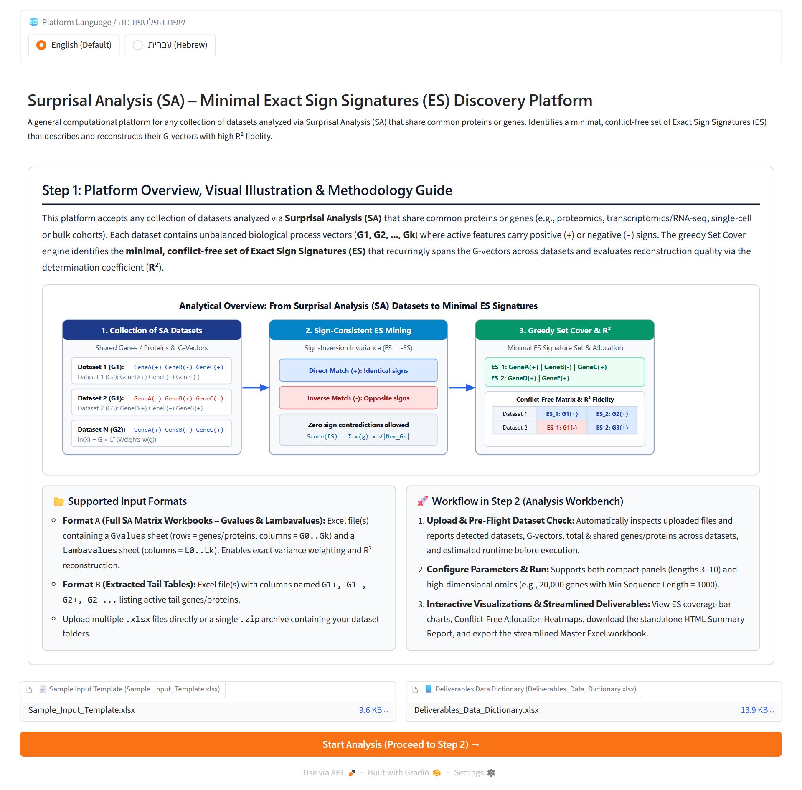
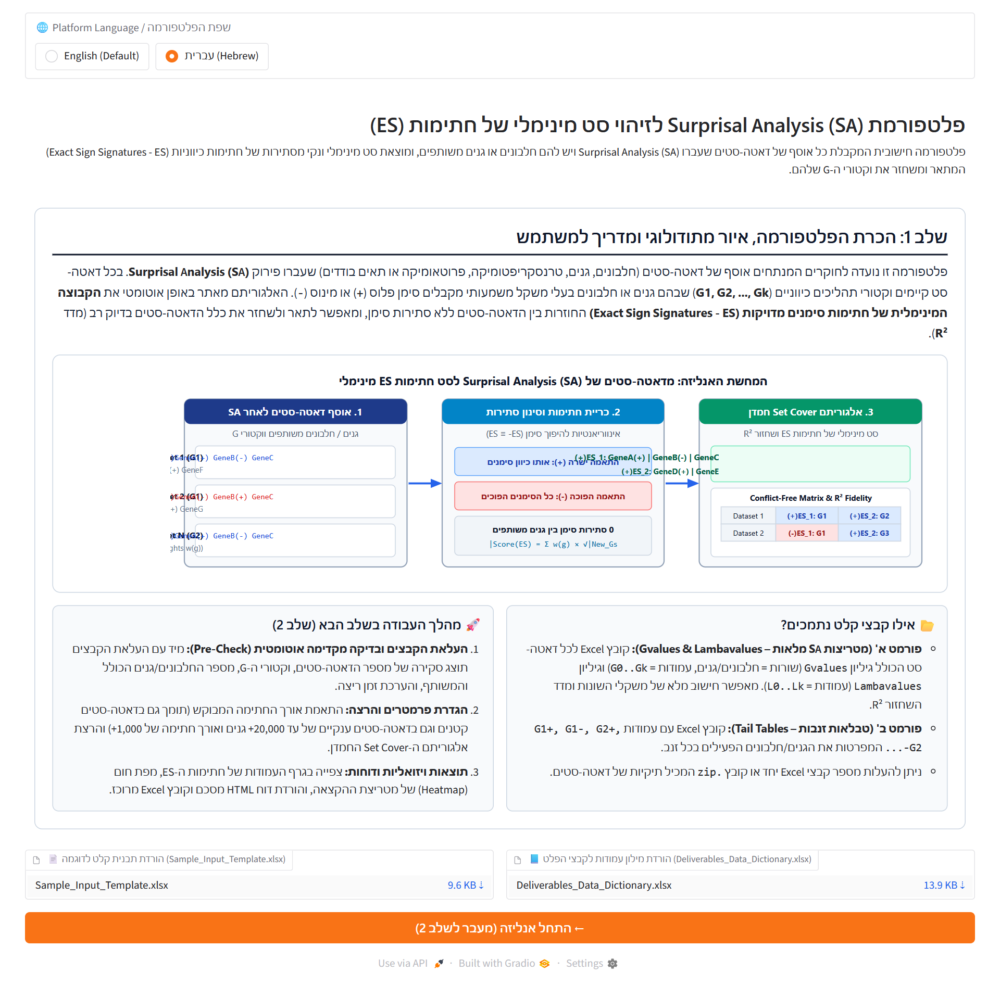
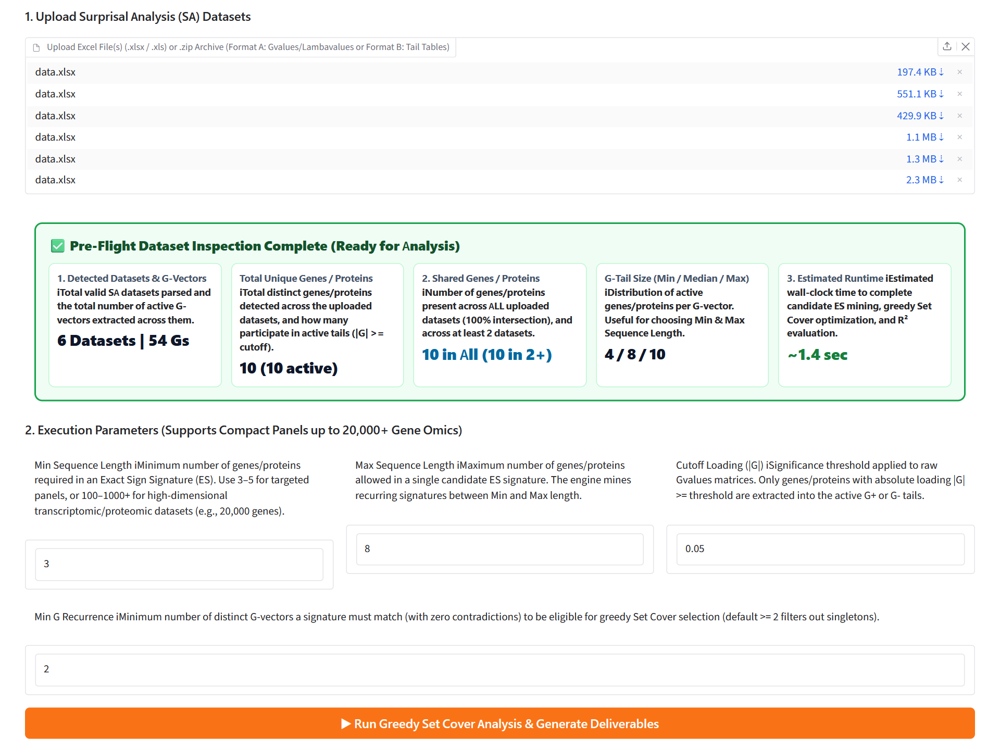
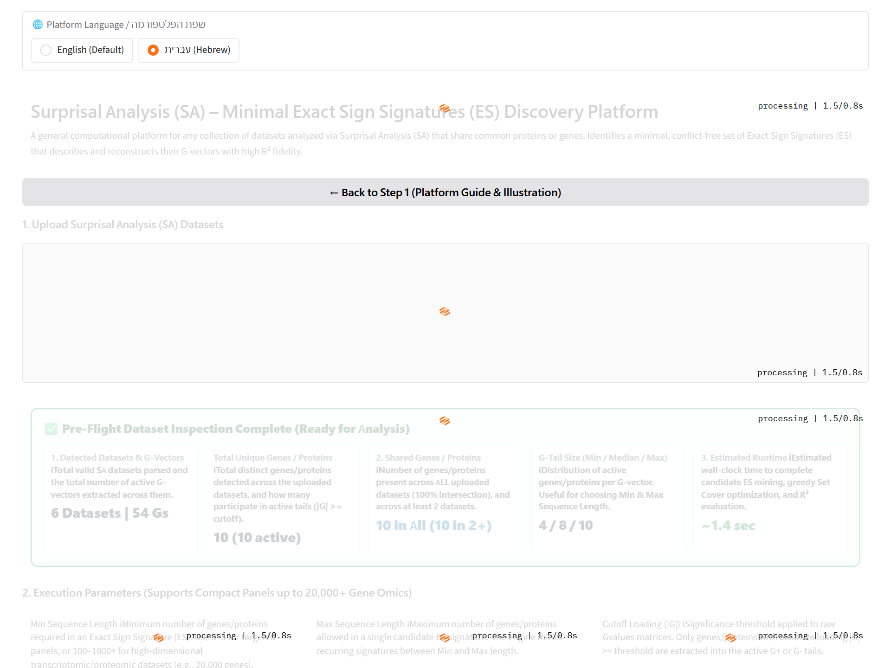
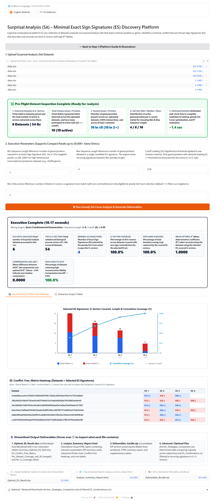
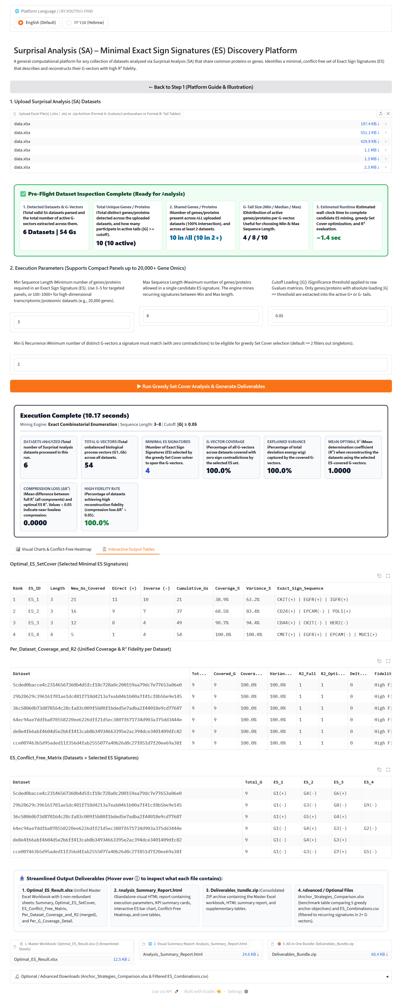

# Surprisal Analysis (SA) – Minimal Exact Sign Signatures (ES) Discovery Platform

A general computational framework and interactive Web GUI for analyzing any collection of datasets decomposed via **Surprisal Analysis (SA)** that share common proteins or genes (proteomics, transcriptomics/RNA-seq, single-cell or bulk cohorts).

The platform extracts active process vectors ($G_1, G_2, \dots, G_k$), discovers a **minimal, conflict-free set of Exact Sign Signatures (ES)** that recurringly spans the $G$-vectors across datasets with zero directional contradictions, and evaluates reconstruction quality via the determination coefficient ($R^2$).

---

## ⚡ Quick Start: Running the Web GUI

### Option A: 1-Click Launcher (Windows)
Double-click `Run_TME_Platform.bat` (or `Launch_GUI.bat`). The launcher connects to GitHub, checks for updates, verifies Python dependencies, and opens the Web GUI at `http://127.0.0.1:7860`.

### Option B: Command Line (Cross-Platform)
```bash
# 1. Clone the repository
git clone https://github.com/natiBirhauz/cancer-research-final-project.git
cd cancer-research-final-project

# 2. Install dependencies
pip install numpy pandas openpyxl gradio

# 3. Launch the Web application
python run_gui.py
```
Open your browser at `http://127.0.0.1:7860`.

---

## 🌐 Key Platform Capabilities

1. **Bilingual Interface (English Default / עברית):**
   Switch seamlessly between English and Hebrew at the top of the platform; the entire interface, tooltips, and guide adapt dynamically.
2. **Guided 2-Step Workflow:**
   - **Step 1 (Overview, Visual Illustration & Guide):** Presents the mathematical methodology, an illustrative diagram showing how multiple SA datasets are compressed into a minimal ES set, input templates, and a **Start Analysis →** button.
   - **Step 2 (Analysis Workbench):** Upload datasets, inspect the automatic Pre-Flight Check, configure parameters, run the greedy Set Cover solver, and explore interactive visualizations and downloads.
3. **Automatic Pre-Flight Dataset Check (prior to execution):**
   Immediately upon file upload, the platform reports:
   - Total datasets, $G$-vectors, and unique genes/proteins detected.
   - Number of genes/proteins shared across **all** datasets and across $\ge 2$ datasets, plus $G$-tail size distribution (Min / Median / Max).
   - Estimated execution time.
4. **Hover Information Tooltips (`ⓘ`):**
   Every execution parameter, summary metric card, and deliverable file includes an `ⓘ` icon with a hover explanation popup.
5. **Scalable Dual-Mode Mining Engine (10 Proteins up to 20,000+ Genes):**
   - **Compact Panels:** Exact combinatorial subset enumeration $\binom{|G|}{k}$.
   - **High-Dimensional Panels (up to 20,000+ genes & `Min Sequence Length = 1000+`):** Automatically engages **Sign-Consistent Pairwise & Cluster Intersection Mining**, discovering large shared signatures in seconds without combinatorial explosion.
6. **Interactive Visualizations & Standalone HTML Summary Report:**
   - **ES Signatures Bar & Cumulative Coverage Chart:** Visualizes covered $G$-vectors (Direct `+` vs Inverse `-`), signature lengths, and cumulative coverage (%).
   - **Conflict-Free Allocation Heatmap:** Interactive color-coded matrix (`Datasets × Selected ES Signatures`).
   - **Downloadable `Analysis_Summary_Report.html`:** Self-contained HTML report with parameters, KPI cards, visual charts, heatmap, and core tables.

---

## 📸 Platform Interface & Visual Walkthrough

Below are high-resolution screenshots illustrating the end-to-end user experience in both English and Hebrew, from platform introduction to interactive visualization and downloadable results.

### Step 1: Platform Overview, Visual Illustration & Guidelines
The initial screen introduces the platform's biological and mathematical rationale, supported input formats, interactive methodology diagram, sample template downloads, and the **Start Analysis →** trigger.

| English View | Hebrew View (עברית) |
| :---: | :---: |
|  |  |

---

### Step 2: Automatic Pre-Flight Dataset Inspection & Execution Parameters
Upon uploading datasets, the workbench runs an immediate pre-flight scan—displaying detected datasets, G-vectors, unique/shared genes, tail distributions, and estimated run time. Every execution parameter includes an interactive `ⓘ` tooltip.

| English Pre-Flight & Parameters | Hebrew Pre-Flight & Parameters (עברית) |
| :---: | :---: |
|  |  |

---

### Step 2 Results: Interactive Visualizations, Conflict-Free Heatmap & Deliverables
After executing the greedy algorithm, the results panel presents KPI summary cards (Universe Coverage, Kinetic Variance, Mean Optimal $R^2$, Compression Loss $\Delta R^2$, High Fidelity Rate), an interactive **ES Bar & Cumulative Coverage Chart**, a color-coded **Conflict-Free Allocation Heatmap**, and direct download links for the unified Excel workbook and visual HTML summary report.



---

### Step 2 Results: Interactive Data Tables
Users can interactively inspect, search, and sort all underlying tables directly within the browser, including `Optimal_ES_SetCover`, `Per_Dataset_Coverage_and_R2`, and `ES_Conflict_Free_Matrix`.



---

## 📂 Supported Input Formats

Upload `.xlsx` / `.xls` files or a `.zip` archive containing multiple dataset folders:

### Format A: Full Surprisal Analysis Workbooks
An Excel workbook (`.xlsx`) per dataset containing two sheets:
- **`Gvalues`:** Feature loading matrix (rows = genes/proteins, columns = $G_0, G_1, \dots, G_k$).
- **`Lambavalues`:** Amplitude matrix (rows = cells/samples, columns = $L_0, L_1, \dots, L_k$).

### Format B: Extracted Tail Tables
An Excel workbook (`.xlsx`) with columns named `G1+, G1-, G2+, G2-, ..., Gk+, Gk-`, listing active genes/proteins per process tail.

---

## 📦 Streamlined Output Deliverables

| Deliverable File | Description |
| :--- | :--- |
| **`Optimal_ES_Result.xlsx`** | **Unified Master Workbook (5 non-redundant sheets):**<br>1. `Summary` – Run parameters & overall metrics<br>2. `Optimal_ES_SetCover` – Selected minimal ES signatures, coverage & variance<br>3. `ES_Conflict_Free_Matrix` – Dataset $\times$ ES allocation matrix (0 conflicts)<br>4. `Per_Dataset_Coverage_and_R2` – Unified coverage, variance & $R^2$ fidelity per dataset<br>5. `Per_G_Coverage_Detail` – Detailed assignment, orientation (`+`/`-`) & overlap per $G$-vector |
| **`Analysis_Summary_Report.html`** | Standalone visual HTML summary report with execution parameters, KPI cards, ES bar chart, Conflict-Free Heatmap, and core tables. |
| **`Deliverables_Bundle.zip`** | Consolidated ZIP archive containing all generated deliverables. |
| **`Anchor_Strategies_Comparison.xlsx`** | *(Optional / Advanced)* Overview table comparing 5 greedy anchor strategies side-by-side. |
| **`ES_Combinations.csv`** | *(Optional / Advanced)* Catalog of recurring candidate ES signatures appearing in $\ge 2$ $G$-vectors (singletons filtered out). |

---

## 📁 Repository Structure

```text
cancer-research-final-project/
├── Launch_GUI.bat                 # 1-Click Windows launcher
├── Run_TME_Platform.bat           # Standalone auto-sync GitHub launcher
├── run_gui.py                     # Primary launcher for the Web GUI workbench
├── web_gui.py                     # Bilingual 2-step Gradio web application
├── pipeline_engine.py             # Core SA -> ES engine, pre-check, charts & HTML report
├── test_gui_execution.py          # Automated verification test suite
├── Sample_Input_Template.xlsx     # Standardized input data template
│
├── Docs/                          # Documentation & reference materials
│   ├── Deliverables_Data_Dictionary.xlsx  # Complete data dictionary for all deliverables
│   ├── Algorithm_Explanation_Guide.md     # Bilingual (Hebrew & English) algorithmic guide
│   ├── ES_Combinations_Specification.md   # Recurring ES catalog specification
│   └── algorithm_workflow_schema.svg     # Algorithm workflow vector diagram
│
├── .gitignore                     # Git exclusion rules
└── README.md                      # Project documentation
```
